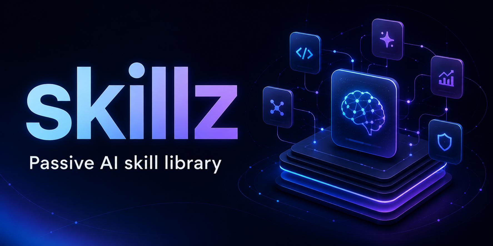

# Skillz

**Find, evaluate, and create AI skills by what they help you accomplish, not by who published them.**

Skillz is an open-ended, **passive capability library**. It combines original skills, individually reviewed third-party references, and source-pinned discovery leads. An entry in the library is not automatically safe, licensed for reuse, behaviorally tested, or authorized to run. Skill discovery is the beginning of a decision, not a permission slip.

[Open Skillz Workbench](https://knapp-kevin.github.io/skillz/) · [Getting started: install a skill](docs/getting-started-with-skills.md) · [Explore capabilities](registry/capability-directory.json) · [Start with a task](docs/capability-quickstart.md) · [Browse and download authored skills](skills/authored/README.md) · [Agent quickstart](AGENT_START_HERE.md)

## Find what you need

| Your goal | Start here | What you get |
| --- | --- | --- |
| Build one custom skill for a task | [Single-skill build workflow](engine/skills/skill-bootstrap/SKILL.md#single_skill_build-one-outcome-one-complete-package) | Compare relevant corpus methods, create a complete portable artifact, challenge it and report its evidence and installation state |
| Solve a particular task | [Capability quickstart](docs/capability-quickstart.md) | Plain-language task examples and relevant skill routes |
| Explore unfamiliar possibilities | [Capability directory](registry/capability-directory.json) | Domain → subdomain → evidence-linked candidates and explicit gaps |
| Search beyond the mapped examples | [Full-corpus discovery contract](docs/discovery/full-corpus-search-contract.md) | A source-neutral search across reviewed identities and wider pinned leads |
| Find a known, reviewed skill | [Governed review name index](registry/governed-review-name-index.json) | Exact-version review identities, including rejected or reference-only entries |
| Use or author a first-party skill | [Authored skill packages](skills/authored/README.md) | Individual complete skill ZIPs, source and manual install guidance |
| Work as an AI agent | [Agent start](AGENT_START_HERE.md) · [Host guidance](AGENTS.md) · [Claude guidance](CLAUDE.md) | Discover, evaluate and act only within the user's approved scope |

Browse the human-friendly [skill categories](skills/README.md) for planning, information management, writing, research, software, agent operations, monitoring, business and career work. The directory is intentionally incomplete; **no match does not mean no such skill exists**.

## What a Skillz skill can do

A few examples of original, self-contained approaches:

| Need | Example |
| --- | --- |
| Follow technical changes without getting lost in announcements | [Technology Change Intelligence](skills/authored/technology-change-intelligence/SKILL.md), with interest-first intake and specialist profiles |
| Assess repository health or prioritize delivery work | [Repository Delivery Assessor](skills/authored/repository-delivery-assessor/SKILL.md) |
| Compare alternatives without overriding mandatory constraints | [Decision Tradeoff Workbench](skills/authored/decision-tradeoff-workbench/SKILL.md) |
| Recover the working state of an interrupted effort | [Context Continuation Contract](skills/authored/context-continuation-contract/SKILL.md) |
| Create, repair or verify an evidence-backed repository README | [Repository README Architect](skills/authored/repository-readme-architect/SKILL.md) |
| Inspect a CI delivery problem before weakening safeguards | [CI Guard](skills/authored/ci-guard/SKILL.md) |

These are **examples, not ranked endorsements or evidence of execution in your host**. For additional study-only examples across technical and creative domains, see the [dated featured-method snapshot](docs/history/readme-snapshot-2026-11-20.md#our-featured-methods-a-small-evidence-based-shelf).

## From discovery to authorized use

1. **Define the outcome.** Specify the task, constraints and what success would look like. Check existing host capabilities before adding another skill.
2. **Discover alternatives.** Search capability areas first, then inspect original packages and third-party candidates by exact source and revision.
3. **Qualify the whole package.** Examine required references, templates, scripts, rights, dependencies, authority scope, static review and any separately observed tests.
4. **Choose deliberately.** Use an existing capability, adopt, adapt, compose, independently create, or make no change. A rejected skill may still offer an idea for lawful independent work.
5. **Deliver within permission.** Installation, repository changes, private data access, outbound calls, memory writes and scheduling need appropriate action-specific authorization and receipts.

For the detailed selection contract, see [consumer discovery and installation](docs/consumer-discovery-and-installation.md). The repository itself does **not** perform background monitoring, installs, or host actions merely because someone browses a skill.

## Evidence and quality

Skillz separates *what is documented* from *what has actually been demonstrated*.

| Evidence | What it establishes | What it does **not** establish |
| --- | --- | --- |
| [Provenance](registry/skills/) and [source terms](registry/sources.yaml) | Publisher, source pin, recorded rights and package identity | Permission to reuse materials with unknown or restricted terms |
| [Static verification](registry/verification/) | A source-specific review of instructions, structure and risks | Live model effectiveness or a production safety pass |
| [Security evidence](registry/security/) | The bounded result of a particular scan, when present | A permanent guarantee or a pass for changed package bytes |
| Behavioral test receipts | Outcomes observed in the exact recorded host and scenario, if executed | Generalization to every model, tenant or workflow |
| User authorization | Approved action and data scope for that request | Blanket permission for future access or side effects |

[Capability-adaptive execution](docs/capability-adaptive-skill-execution.md) is the repository-wide design rule. We provide extra structure for constrained models without restricting capable models from using better authorized methods. **Safety, privacy, evidence requirements, and authority limits never loosen with model capability.** Downloadable authored packages must remain useful offline, without relying on external repository policy files. See the [authoring template](docs/skill-template.md) and [review standard](docs/skill-verification.md).

## Recorded library snapshot

Source records checked November 20, 2026. These are distinct populations, not additive counts or claims of approved installations. For current numbers, follow the linked ledgers.

| Measure | Recorded state | Source |
| --- | ---: | --- |
| Canonical capability domains / subdomains | **33 / 247** | [Capability directory](registry/capability-directory.json) |
| Governed review identities | **1,049** | [Name index](registry/governed-review-name-index.json) |
| Identities linked to capability examples | **133** | [Capability directory](registry/capability-directory.json) |
| Authored skill packages indexed | **34** | [Authored-skill index](registry/authored-skills-index.json) |
| Historical source packages retired | **44 / 44** | [Retirement ledger](registry/migration/frostwulf-independent-replacement-ledger-20261118.json) |

The 44 historical entrypoints were consolidated into 21 independently authored replacement packages under owner-accepted bounded evaluation procedures. Their original source identities remain in Git history. **Independent original-vs-replacement host parity, 1.5× measured quality improvement and historical copyright ownership remain unproven**; retirement does not erase those qualifications. See [issue #738](https://github.com/Knapp-Kevin/skillz/issues/738).

The source corpus is larger than the governed review set, and the coverage map has gaps. A review identity is not an approved installation. **Do not add discovery paths, research leads, governed records and authored packages into a fictional total.**

## Contributing and maintaining

New original skills belong under [`skills/authored/`](skills/authored/), with a complete standalone package, provenance, licensing, precise capability routes and review evidence. Third-party references remain separately attributed; the repository's [MIT license](LICENSE) does **not** relicense external source, code, assets or derivatives.

| Maintainer reference | Purpose |
| --- | --- |
| [Governance index](docs/GOVERNANCE_INDEX.md) | Decision rights, source boundaries and controlled workflow rules |
| [Candidate intake](docs/candidate-intake.md) · [Third-party provenance](docs/third-party-provenance.md) | Source admission, rights and reuse restrictions |
| [Security policy](docs/security-scanning.md) · [Verification rubric](docs/skill-verification.md) | Independent evidence gates |
| [System state](docs/SYSTEM_STATE.md) · [Curation queue](CURATION_QUEUE.md) | Detailed recorded inventory and unfinished work |
| [Material changes](CHANGES.md) · [Maintainer workboard](MAINTAINER_WORKBOARD.md) | Dated delivery history and active issue-level priorities |
| [Archived previous README](docs/history/readme-snapshot-2026-11-20.md) | Original historical progress reports and study-method shelf, preserved without cluttering this entry point |

**Skillz is for finding and improving capabilities.** When a skill is selected, its usefulness must be demonstrated in the user's actual context.
