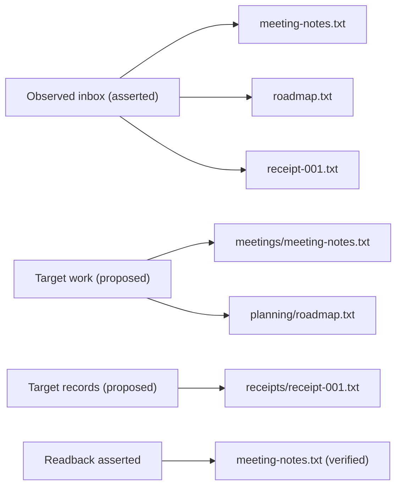

# Fictional organization progress view

All filenames and folders in this file are invented. **This is a
design/contract example, not a successful file move, account inspection,
saved checkpoint or live agent run.** Native file locators are not
rendered by the offline helper; these are read-only safe display aliases.

## Before: observed source snapshot

    inbox/
      meeting-notes.txt
      roadmap.txt
      receipt-001.txt
      misc-note.txt
    archive/
      old-roadmap.txt

The observed source view is a caller-supplied snapshot. It cannot
prove there are no other accessible files without a separately verified
complete collection enumeration.

## After: proposed future structure (NOT APPLIED)

    work/
      meetings/
        meeting-notes.txt
      planning/
        roadmap.txt
    records/
      receipts/
        receipt-001.txt
    archive/
      old-roadmap.txt                 (unchanged)
    unplaced:
      inbox/misc-note.txt            (needs owner decision)

The target tree does not imply any move was approved or performed.
The unplaced file is not discarded or force-fitted into a category.
In the actual helper output it remains under its observed "inbox"
location with UNPLACED_KEEP_CURRENT, not an actual folder called
"unplaced"; the list above is just an explanatory review queue.

## During: read-back-attested state in the fictional plan

    work/
      meetings/
        meeting-notes.txt            (VERIFIED / receipt asserted)
      planning/
        roadmap.txt                  (EXECUTED / NOT VERIFIED)
    records/
      receipts/
        receipt-001.txt              (BLOCKED / NOT MOVED)

Progress: 1 / 3 planned relocations have a qualifying *caller-supplied*
receipt and latest observed destination. That would be provisionally
33% of an explicitly source-declared complete three-relocation plan.
The one EXECUTED operation is not counted as verified. The blocked
operation remains outstanding. A previous/scheduled run's visual must
not supersede the current source ledger or permission checks.

## Optional Mermaid preview, derived only from synthetic data

The consuming agent may render Mermaid when the host supports it,
otherwise use the plain-text tree. This simple static preview is only
illustrative; the optional helper generates deterministic views from
strict validated input, not hard-coded success claims.

## Long-running agent acceptance

A future approved scheduled agent can generate a new visualization only
after checking source and private-checkpoint permission and source
revision/plan identity again. It must be able to report a truly
unchanged run, a changed plan as REPLAN_REVIEW, an unobserved file
as a privacy/coverage hold, and verified-to-unverified regression.
No diagram is an operation receipt. No user data or live scheduled
task appears in this example.
